<!-- 🎬 HERO — portrait + name + rotating roles -->

 

  

<!-- 🧩 LEFT: what I build   •   🔁 RIGHT: how I work -->

  

<!-- ⚛️ TECH STACK -->

  

<!-- 🪪 DEVELOPER ID + IMPACT DASHBOARD -->

  

<!-- 📊 LIVE GITHUB STATS — commits, repos, PRs, streak, languages (refreshed daily) -->

  

## 🚀 Featured builds — owned end to end

| Project | What it is | Stack | Impact |
|:---|:---|:---|:---:|
| [**Jobstm**](https://jobstm.co/) | Verification & gig marketplace — Expo app, Next.js portals and admin console on one role-checked REST API (14 routers) | `Expo` `Next.js` `Node.js` `PostgreSQL` `AWS` | ⚡ **2.4×** faster hiring |
| [**Sustainext**](https://sustainext-udm.sustainext.ai/) | Enterprise ESG console — drag-and-drop ingestion where OCR reads documents and an LLM proposes the GHG Scope | `Next.js` `TypeScript` `OCR` `LLM` | 📉 **−70%** audit friction |
| [**Sole & Ledger**](https://funkyfashion.shop/login) | Scan-first POS & inventory — one DB transaction per sale, stock ledger, QR returns, WhatsApp bills | `Next.js` `NextAuth` `PostgreSQL` `pdf-lib` | ⏱️ **<10s** checkout |
| [**Aadidhara**](https://aadidhara.com/) | Bilingual farm-to-home marketplace — farmer KYC, pricing engine, Razorpay / COD, order tracking | `Next.js` `Tailwind` `PostgreSQL` `Razorpay` | 🌾 **+35%** producer revenue |

 

## 🧭 The journey so far

  

## 📈 My shipping pulse

*Twelve months of commits, one glowing ridge per month — the taller the peak, the busier the day. Rebuilt every day.*

  

<!-- 💌 LET'S CONNECT -->

  

 

**Designing with code. Architecting with empathy.** 🧡

